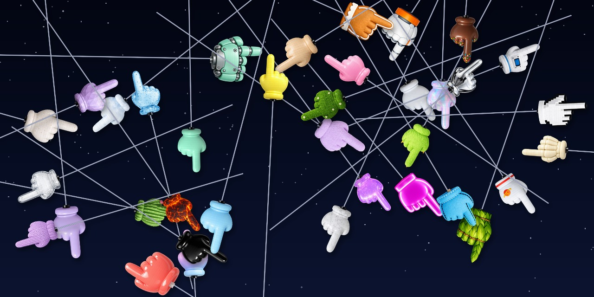
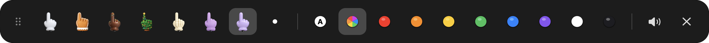
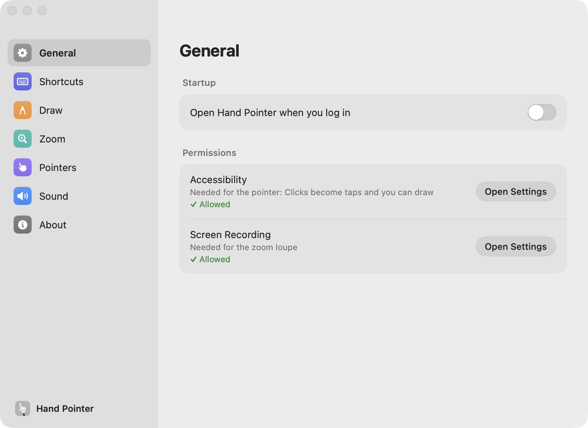
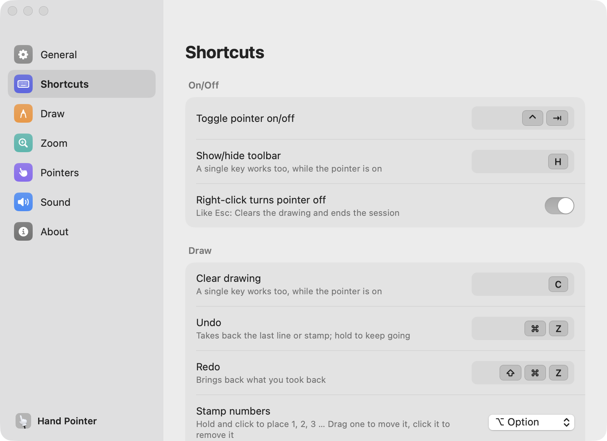
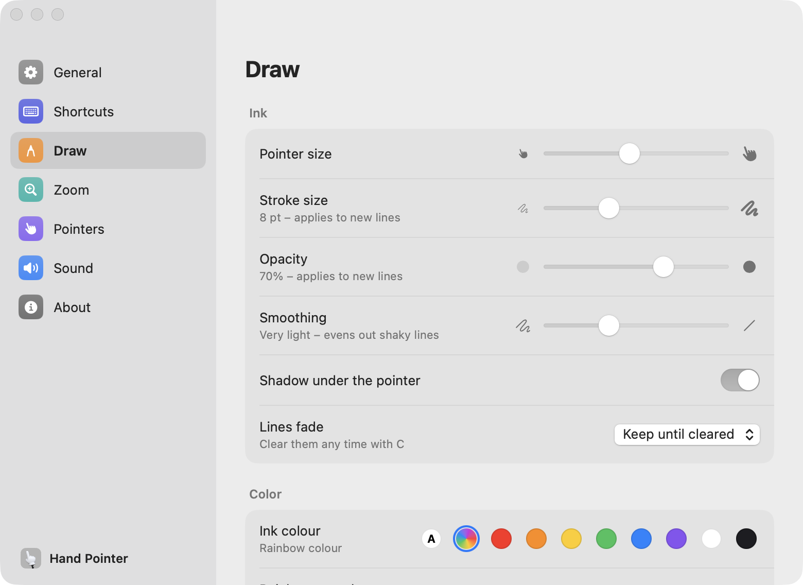
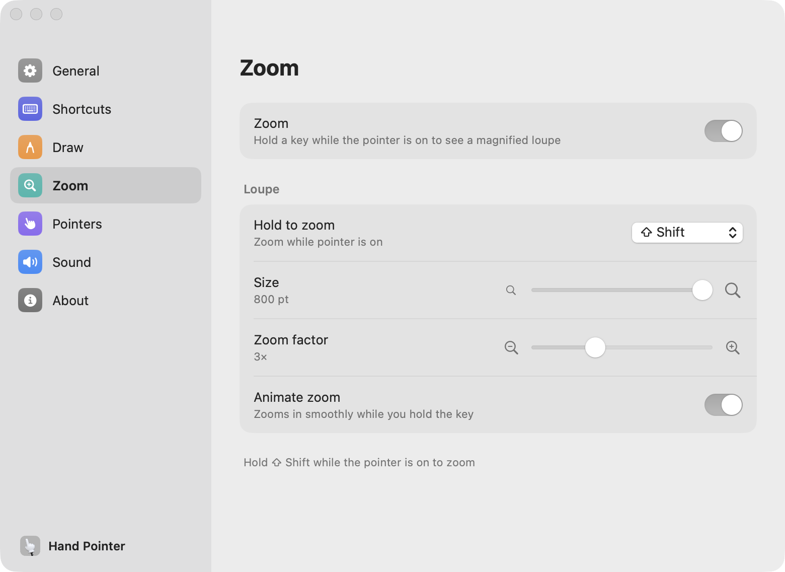
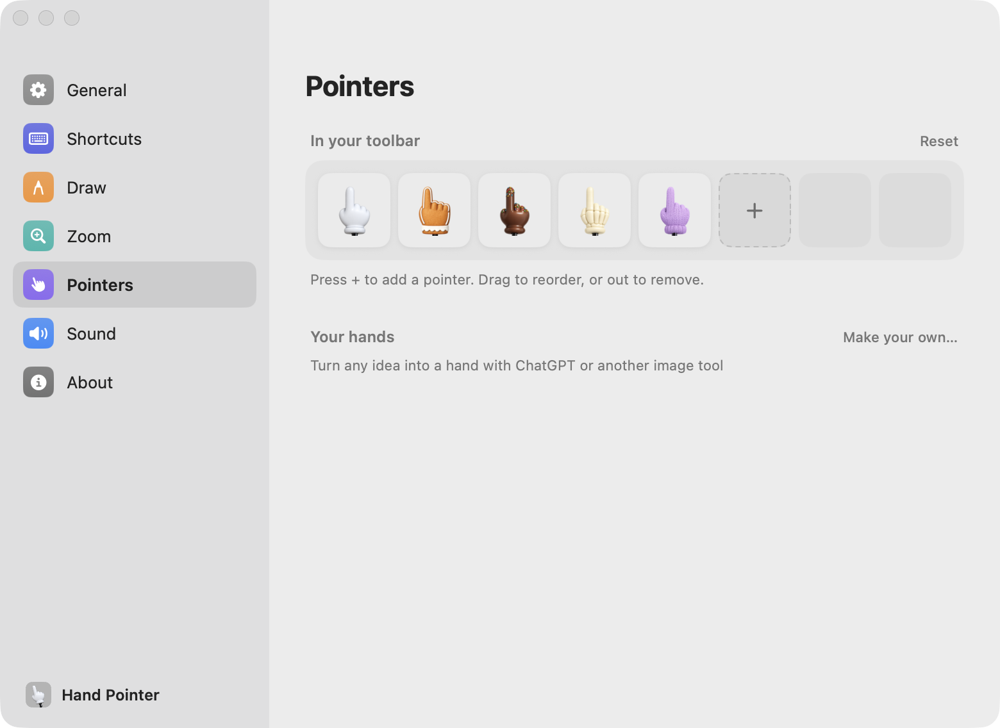
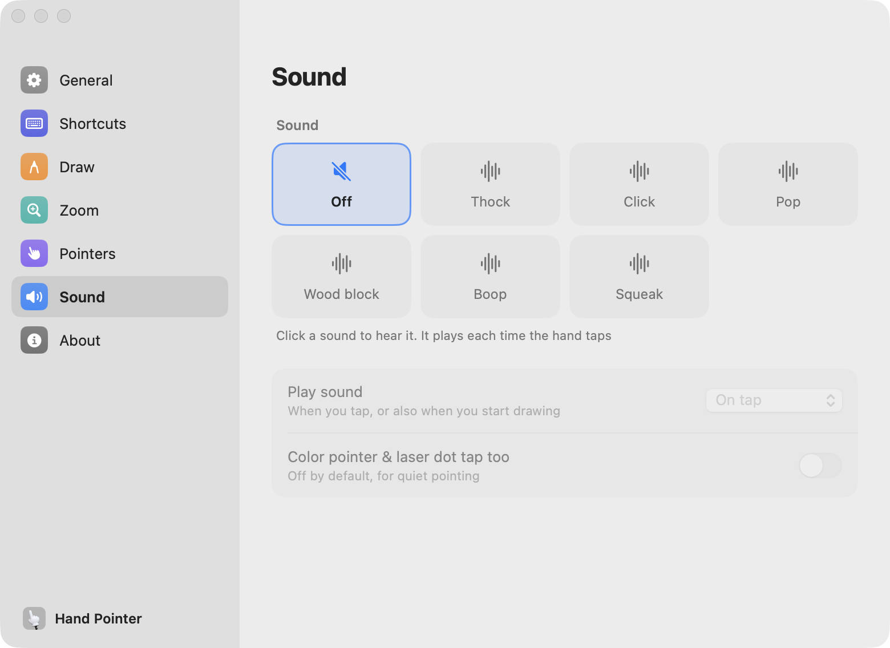

<p>
  <a href="https://github.com/esreverse/tinypointer/releases/latest"></a>
  
  
  <a href="./LICENSE"></a>
</p>



# [Download for macOS](https://github.com/esreverse/tinypointer/releases/latest/download/TinyPointer.dmg)


# TinyPointer

**A tiny hand on a stick for your Mac.** Turn it on, and your cursor becomes a hand that points, taps and
draws on top of everything on screen. Made for demos, screen recordings, teaching and video calls.
Nothing underneath gets clicked, and one key puts your normal cursor back.


## Features

- **Point and tap:** Clicks become taps of the hand, with a sound and a circle where you tap, so people
  watching see exactly what you mean.
- **Draw anywhere:** Hold and drag to draw over any app. Pick a colour, the stroke size and the opacity,
  and let lines fade on their own or keep them until you clear them.
- **Rainbow ink:** Lines run through every colour as you draw, with adjustable speed. Each new line can
  start further around the colour wheel, or carry on exactly where the last one ended.
- **Zoom loupe:** Hold ⇧ to magnify the screen around the pointer, with a Liquid Glass ring.
- **37 pointers and your own:** Toy hands, a laser dot, a color pointer that shows your exact stroke, or a
  hand you make yourself from any image.
- **A toolbar that stays out of the way:** Pointers, colours and sound in one bar. Drag it anywhere, hide
  it with a key, and it disappears while you use your Mac for real.
- **Shortcuts for everything:** Clear, switch colour or pointer, mute, show the toolbar. Single keys work
  while the pointer is on and never get in the way of your other apps.
- **Updates itself:** New versions install automatically; a manual check shows what is new.

<p align="center">
  
</p>


## Screenshots

<table>
  <tr>
    <td width="50%" valign="top">
      <picture>
        <source media="(prefers-color-scheme: dark)" srcset="./.github/screenshots/settings-general-dark.png" />
        
      </picture>
      <p align="left"><b>General:</b> Startup, updates, permissions</p>
    </td>
    <td width="50%" valign="top">
      <picture>
        <source media="(prefers-color-scheme: dark)" srcset="./.github/screenshots/settings-shortcuts-dark.png" />
        
      </picture>
      <p align="left"><b>Shortcuts:</b> Every action on a key</p>
    </td>
  </tr>
  <tr>
    <td width="50%" valign="top">
      <picture>
        <source media="(prefers-color-scheme: dark)" srcset="./.github/screenshots/settings-drawing-dark.png" />
        
      </picture>
      <p align="left"><b>Draw:</b> Size, opacity, colours, rainbow</p>
    </td>
    <td width="50%" valign="top">
      <picture>
        <source media="(prefers-color-scheme: dark)" srcset="./.github/screenshots/settings-zoom-dark.png" />
        
      </picture>
      <p align="left"><b>Zoom:</b> Loupe size, factor, animation</p>
    </td>
  </tr>
  <tr>
    <td width="50%" valign="top">
      <picture>
        <source media="(prefers-color-scheme: dark)" srcset="./.github/screenshots/settings-pointers-dark.png" />
        
      </picture>
      <p align="left"><b>Pointers:</b> Your toolbar and your own hands</p>
    </td>
    <td width="50%" valign="top">
      <picture>
        <source media="(prefers-color-scheme: dark)" srcset="./.github/screenshots/settings-sound-dark.png" />
        
      </picture>
      <p align="left"><b>Sound:</b> Tap sounds and when they play</p>
    </td>
  </tr>
</table>


## Install

1. Download **TinyPointer.dmg** with the button above.
2. Open it and drag TinyPointer to **Applications**.
3. Open TinyPointer. The first time, macOS says it can't check the developer, because the app is not
   notarized yet. Go to **System Settings → Privacy & Security** and click **Open Anyway**.
4. Allow **Accessibility** when asked.
5. Optional: for the zoom loupe, turn on Zoom in **Settings → Zoom** and allow **Screen Recording**.

TinyPointer lives in the menu bar. Click its icon or press **⌃⇥** to turn the pointer on.


## Use

| | |
|---|---|
| Click the menu bar icon, or **⌃⇥** | Turn the pointer on or off |
| Right-click the menu bar icon | Menu and Settings |
| Click | Tap (nothing underneath gets clicked) |
| Hold and drag | Draw on the screen |
| Hold **⌃** | Click your Mac for real |
| Hold **⇧** | Zoom loupe (turn it on in Settings first) |
| **Q** | Clear the drawing |
| **A** / **R** | Automatic colour / rainbow colour |
| **X** / **Y** | Next / previous pointer (hold to step through) |
| **H** | Show or hide the toolbar |
| **M** | Sound on or off |
| **⌘,** | Settings |
| **Esc** or right-click | Clear everything and turn the pointer off |

Single keys only work while the pointer is on. All shortcuts can be changed in **Settings → Shortcuts**.


## Settings

| Page | What you can change |
|---|---|
| **General** | Open at login, automatic updates, check for updates, permission status |
| **Shortcuts** | Every shortcut, right-click to turn off, the key to click for real |
| **Draw** | Pointer and stroke size, opacity, shadow, how long lines stay, ink colour, rainbow speed and shift, tap circle, toolbar |
| **Zoom** | Hold key, loupe size, zoom factor, animation |
| **Pointers** | Which pointers are in the toolbar and in what order, and your own hands |
| **Sound** | Tap sound, play on tap only or on tap and draw |


## Permissions And Privacy

- **Accessibility** lets TinyPointer catch your clicks and turn them into taps and drawings. Without it,
  the hand can't do anything.
- **Screen Recording** is only needed for the zoom loupe. The picture stays on your Mac and is only used to
  draw the loupe.
- TinyPointer doesn't collect or send any data. The only connection it makes is the update check to this
  repository's releases.


## FAQ

**macOS says TinyPointer can't be opened.**
It isn't notarized by Apple yet. Open it once via **System Settings → Privacy & Security → Open Anyway**.

**The hand doesn't react to clicks.**
Accessibility isn't allowed. Check **Settings → General → Permissions** and open System Settings from there.

**How do I click something for real while the pointer is on?**
Hold **⌃** and click. You can change that key in **Settings → Shortcuts**.


## Build From Source

For development only; to just use TinyPointer, download the DMG above.

```bash
scripts/build-local.sh --install
```

Compiles TinyPointer from source, signs it with a local certificate, replaces `/Applications/TinyPointer.app`
and starts it.

```bash
scripts/release.sh --skip-notarize
```

Builds the DMG and the update feed for a release into `dist/release/`. The release notes come from
[CHANGELOG.md](CHANGELOG.md).


## Credits

TinyPointer is developed by [Eric Singhartinger](https://github.com/esreverse). It is based on
[TinyHand](https://github.com/nilbuild/tinyhand) by Kamran Ahmed, used under the MIT License.


## License

MIT. See [LICENSE](LICENSE).
